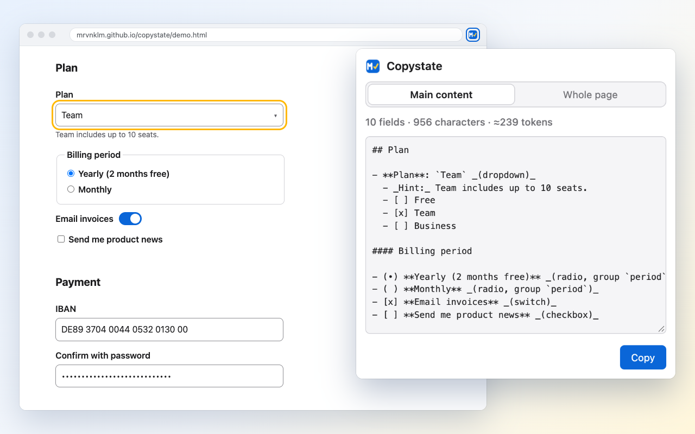

# Copystate

[Deutsch](README.de.md) · [Website](https://mrvnklm.github.io/copystate/) · [Privacy policy](https://mrvnklm.github.io/copystate/privacy.html) · [Demo page](https://mrvnklm.github.io/copystate/demo.html)

**Copy the page you see as Markdown for your AI assistant, including every form field with its current value and the options of its dropdowns.**

Article clippers drop forms. Copystate keeps them: what you typed, ticked and selected, plus the options a custom dropdown
only renders while it is open. Paste the result into any LLM and ask about the form or settings page in front of you.



## Install

| Browser | Link | Minimum version |
|---|---|---|
| Firefox | [addons.mozilla.org](https://addons.mozilla.org/firefox/addon/copystate/) | 140 (Android 142) |
| Chrome | Chrome Web Store, in review | 102 |
| No install | Console snippet, see [Development](#development) | any |

## Usage

1. Click the toolbar icon (in Chrome, pin it from the puzzle menu first) or press `Alt+Shift+M` (`Option+Shift+M` on
   macOS). The popup shows a preview with field, character and rough token counts. The page is not touched.
2. If the page has dropdowns whose options only exist while open, click **Open dropdowns**. Each one opens briefly and
   closes again; nothing is selected or submitted.
3. Click **Copy** or press Enter.

Choose **Main content** (`main` plus open dialogs, or the whole page if there is no `main`) or **Whole page** (also header,
navigation, sidebar).

<details>
<summary>Example output</summary>

```markdown
## Plan

- **Plan**: `Team` _(dropdown)_
  - _Hint:_ Team includes up to 10 seats.
  - [ ] Free
  - [x] Team
  - [ ] Business

#### Billing period

- (•) **Yearly (2 months free)** _(radio, group `period`)_
- ( ) **Monthly** _(radio, group `period`)_

## Payment

- **IBAN**: `[redacted]` _(text)_
- **Confirm with password**: `[redacted]` _(password)_
```

</details>

## What is read

| | |
|---|---|
| Read | Headings, text, tables (also with fields in cells), links, tabs, dialogs, open shadow DOM. Native fields, radios, checkboxes, switches, `select`, ARIA comboboxes and custom dropdowns, tested with MUI, Ant Design, Element Plus, PrimeVue, Radix, Reka UI, Headless UI and react-select |
| Not read | Content behind unselected tabs or radios, collapsed `details`, iframes, closed shadow DOM. A note marks what was skipped |
| Redacted | Form fields for passwords (also revealed ones), card numbers, PINs, IBANs, one-time codes and tokens, detected by type, `autocomplete`, name, label and placeholder. Credentials and token parameters in URLs. Text the page merely displays is not redacted |
| Escaped | Page text cannot forge fields, headings or links in the output |

## Privacy

- Runs locally. The extension sends nothing: no network requests, no analytics, no account.
- Permissions: `activeTab` and `scripting` only. No access to other tabs, nothing in the background.
- Stores one setting (the scope). Page content is never stored.
- Full text: [privacy policy](https://mrvnklm.github.io/copystate/privacy.html).

## Known limitations

- Some custom dropdowns cannot be opened by script; their options are marked as not readable.
- Closing a dropdown can still reach a modal that listens for Escape on `document` in the capture phase.

## Development

Requires [Bun](https://bun.sh) and Node.js. The Firefox extension test needs Firefox (`FIREFOX_BIN` overrides the path).

| Task | Command |
|---|---|
| Set up | `bun install`, `bunx playwright install`, `git config core.hooksPath .githooks` |
| Build | `bun run build` → `dist/chrome`, `dist/firefox`, `dist/console-snippet.js` |
| Load unpacked | Chrome: `chrome://extensions` → Developer mode → Load unpacked → `dist/chrome`. Firefox: `about:debugging` → This Firefox → Load Temporary Add-on → `dist/firefox/manifest.json` |
| Test | `bun run test`: the core in Chromium, Firefox and WebKit, real dropdown libraries, the extension end to end in Chrome and Firefox |
| Check real sites | `bun run sweep [chromium\|firefox] [url…]` reports dropdowns left open |
| Package | `bun run package` → `dist/artifacts/*.zip` |
| Console snippet | After `bun run build`, paste `dist/console-snippet.js` into the DevTools console (Chrome asks you to type `allow pasting` first). Unlike the popup, it opens dropdowns right away |

<details>
<summary>Project layout</summary>

- `src/page-to-markdown.js`: the core, a self-contained function injected with `scripting.executeScript({ func })`. It must
  not reference anything outside itself.
- `src/popup.*`: the popup. `scripts/build.mjs` builds the Chrome and Firefox variants from one manifest.
- `tests/`: Playwright for the core and Chrome, Selenium with geckodriver for the Firefox extension.
- `docs/`: website, privacy policy and demo page (GitHub Pages). `store/`: listing texts and images.

</details>

## Contributing

Bug reports and pull requests are welcome. If a page is read wrongly, open an
[issue](https://github.com/mrvnklm/copystate/issues) with the URL or a snippet of its HTML. Before a pull request, run
`bun run test`.

## License

[MIT](LICENSE)
